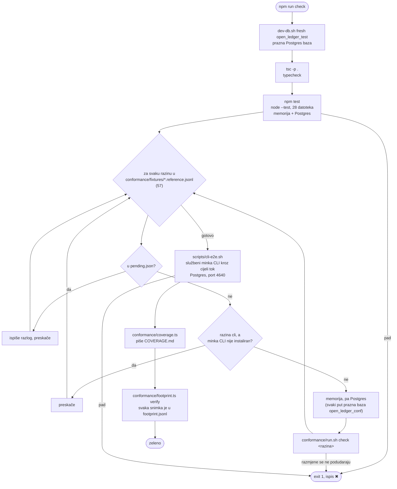
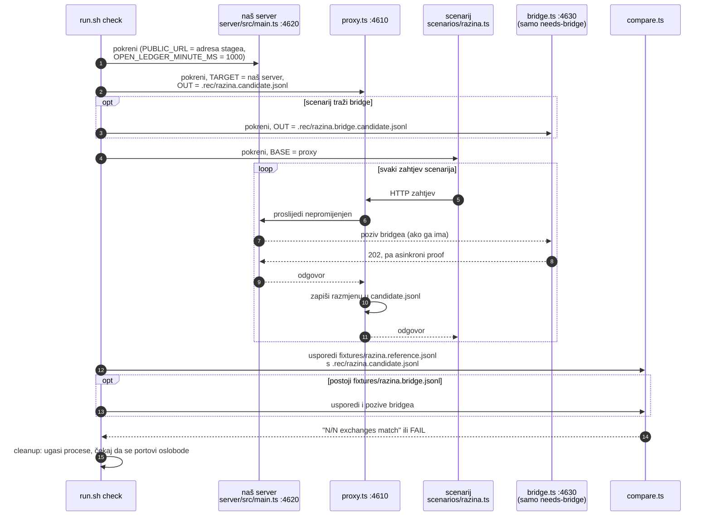
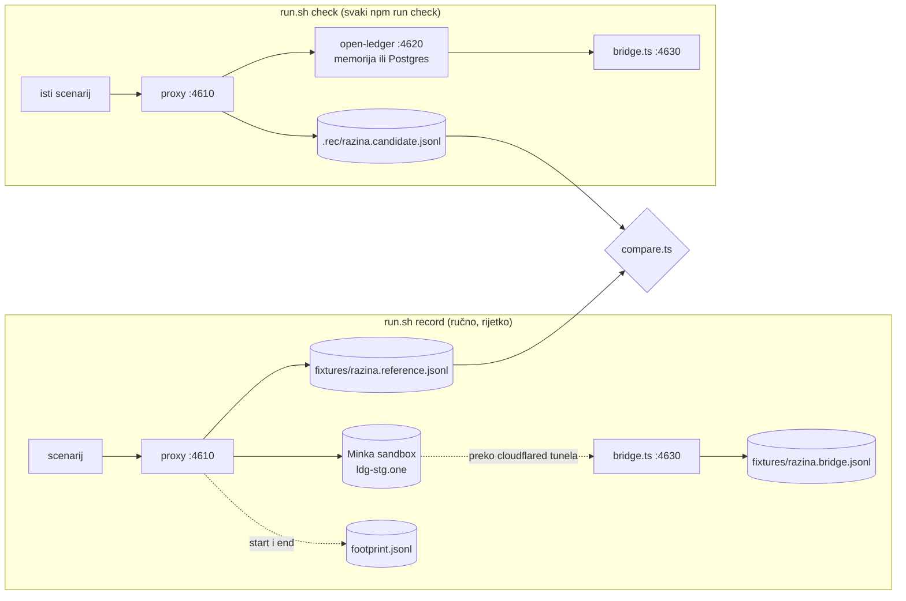

# Što radi `npm run check`

`npm run check` (`scripts/check.sh`) je sve što mora biti zeleno prije commita.
Radi **potpuno lokalno**:

- **ne zove Minka staging** (`ldg-stg.one`). Staging se zove samo u `run.sh record`,
  a check ga nikad ne pokreće.
- **ne zove nijedan LLM**.
- **ne koristi Docker**. Postgres je projektni, iz Homebrewa (`scripts/dev-db.sh`,
  podaci u `.rec/pgdata`, port 5439).

Traje dulje od 10 minuta jer se 57 conformance razina vrti dvaput (memorija i Postgres),
a neke čekaju stvarno vrijeme: `daywindow` 40 s, `cli` oko 50 s.

## Tok

## Jedna razina: `run.sh check <razina>`

Scenarij (`conformance/scenarios/<razina>.ts`) je obični TypeScript klijent koji preko
`@minka/ledger-sdk` ili HTTP-a izvodi tok, npr. ledger → walleti → intent → saldo.
Isti scenarij se izvodi i kod snimanja i kod provjere. Razlika je samo u tome kamo
proxy prosljeđuje.

### Što `compare.ts` provjerava

| Kako | Što |
|---|---|
| Strogo | HTTP status, oblik tijela, svaka normalizirana vrijednost |
| Normalizirano | trenuci, luidovi, ključevi, hashevi, potpisi, handle ledgera iz runa: zamijenjeni oznakama po redu prvog pojavljivanja, pa se identitet i dalje provjerava (isti luid mora se vratiti tamo gdje se vratio i u snimci) |
| Blago (ispis, ne pad) | tekst `detail` u greškama |
| Ignorirano | `custom.trace`, jer referentni ledger vraća stack trace koji ne kopiramo |

## Snimanje i provjera

Fixture u `conformance/fixtures/` nastaje jednom, snimanjem na sandboxu (`run.sh record`).
Check tu snimku samo čita.

Snimanje stvara ledger na sandboxu koji se ne može obrisati, pa se svaki run zapisuje
u `conformance/footprint.jsonl` prije prvog zahtjeva. `footprint.ts verify` na kraju
checka provjerava da za svaku fixture postoji zapis i da je `docs/sandbox-footprint.md`
ažuran. Ta provjera samo čita lokalne datoteke.

## Praktično

- **Portovi 4610, 4620, 4630 i 4640** su zauzeti dok check radi. Drugi conformance run
  u isto vrijeme odbija start (`port … is in use`). Prije je dijeljenje proxyja pomiješalo
  dva scenarija u jednu fixture (`access4`).
- **Logovi:** `.rec/test.log` (unit), `.rec/conf.log` (zadnja razina), `.rec/server.log`,
  `.rec/proxy.log`, `.rec/cli.log`.
- **Posebne oznake u scenariju:** `// day-boundary` (daywindow: server dobiva granicu dana
  40 s unaprijed), `// minute-ms: <n>` (vlastita duljina minute za istek intenta),
  `needs-bridge`, `needs-local-server`.
- **Pending:** razina u `conformance/pending.json` se preskače s razlogom. Danas je
  datoteka prazna.
